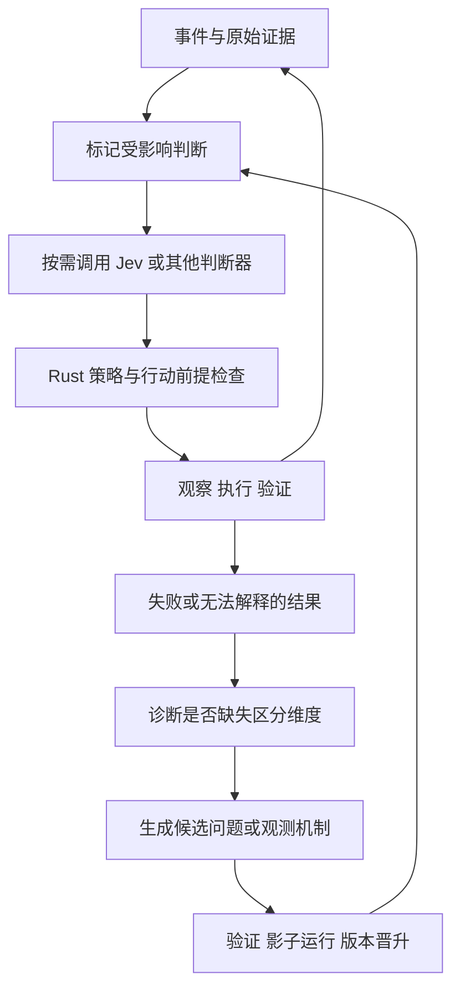

# jev-harness：研究目标与实验设计

> **研究命题：探索 Jev 能否使一种可维护、可修订、可扩展自身认知结构的 Agent Harness 成为实用架构。**
>
> 系统应能维护支撑行动的证据，发现现有问题不足以区分关键情形，并通过新的问题和观测能力改善后续行为。

- 文档版本：0.1
- 编写日期：2026-09-22
- 项目形态：Rust 实现的实验性 Agent 运行时，配套 TUI 研究界面。
- 文档状态：研究目标与拟议实验协议；不包含已完成的实现、实测结果或性能承诺。
- 研究性质：个人学习项目，以可复现的原型、对照实验和明确的否定结论为主要产出。

## 1. 研究愿景

本项目研究一个架构层面的可能性：当语义判断足够廉价、快速且可靠时，Agent 能否以持续维护的目标、证据、判断和能力为基本组成单元，并通过执行反馈改进自己理解任务的方式。

在这一设想中，运行时持续处理外部事件，维护当前判断的有效性，调度观察、执行和验证。LLM 提供开放式推理与结构生成；Jev 对明确的问题提供类型化判断；Rust 负责版本、依赖、权限、调度和执行语义。模型的局部判断通过程序结构组合为整体行为。

项目关注三种相互连接的能力：

1. **维护认知状态。** 每项重要判断记录依据、适用范围和失效条件；证据改变时，撤销受影响的执行资格，并重算必要部分。
2. **修订认知结构。** 当现有问题无法区分需要不同动作的情况时，生成并检验新的区分维度，更新任务状态表示。
3. **扩展观测能力。** 当现有工具无法提供关键证据时，建设可验证的观测器、实验或工具接口，使后续行动获得更直接的依据。

远期目标是形成一种累积能力：系统处理相关任务后，留下的不仅是历史记录，还包括经过检验的问题、依赖关系、观测方法和可复用能力。这些结构应当改善未见任务上的行为，并能在环境改变后被撤回或修订。

**核心问题：Agent 能否通过学习“需要知道什么”和建设“如何知道”的能力，获得传统循环之外的结构性优势？**

## 2. 研究依据与能力边界

### 2.1 Jev 提供的接口基础

根据截至文档日期核对的官方说明，Jev 接收共享 state 和一组类型化问题。Choice 返回选项及其分布，Score 返回量表评分及分布，两者另有 confidence；Noul 返回是非命题为真的概率。问题可以混合在同次请求中，各自基于同一 state 独立评估。[官方介绍](https://docs.typesafe.ai/introduction)、[Noul 文档](https://docs.typesafe.ai/primitives/noul)

本研究将这一接口视为实现语义算子的候选基础。以下边界贯穿所有实验：

- 类型约束不保证语义判断正确，也不保证候选选项包含正确答案。
- confidence 是由答案分布计算的统计量，不能直接当作动作成功率。[Confidence 文档](https://docs.typesafe.ai/confidence)
- 同次请求的问题独立评估，不代表所判断的事件在统计上独立；不得将多个回答直接相乘，声称获得整条计划的成功概率。
- Noul 概率表达命题成立的估计，不表达属性强度；未知证据、调用失败和接近 0.5 的回答必须分开记录。
- 一个问题的答案不会自动成为同批其他问题的输入。有数据依赖的判断需要代码组合或分轮调用。
- 实际延迟、费用、判断质量与校准表现须在本项目任务、输入规模和网络环境中测量，不采用厂商宣传数字作为实验结果。

### 2.2 已有研究提供的基础

| 研究基础 | 可借鉴的思想 | 本项目进一步检验的问题 |
| --- | --- | --- |
| [Doyle：真值维护](https://dspace.mit.edu/entities/publication/ec59eeeb-5e11-44df-ab1b-6524ca7ab9ff) | 保存信念的依据，前提变化后修订相关信念 | 开放语言判断的依赖、冲突与失效，能否被可靠维护？ |
| [Acar：自调整计算](https://csd.cmu.edu/academics/doctoral/degrees-conferred/umut-a-acar) | 跟踪依赖，通过变化传播复用计算 | 语义判断的依赖是否足够局部，增量更新是否值得其维护成本？ |
| [CEGAR：反例引导的抽象精化](https://www.cs.cmu.edu/~emc/papers/Conference%20Papers/Counterexample-guided%20Abstraction%20Refinement.pdf) | 通过反例识别抽象遗漏并精化模型 | 执行失败能否指导问题集合与状态表示的改进？ |
| [LOTUS：语义算子](https://arxiv.org/abs/2407.11418) | 将语义处理表达为可组合、可优化的计算 | 语义算子进入持续行动环境后，如何处理版本、时效和副作用？ |
| [SIGIL：技能编译](https://arxiv.org/abs/2607.27309) | 将技能中的程序结构编译为执行机制，保留必要模型判断 | 编译后的语义前提如何持续维护，何时需要局部重建？ |
| [Kirsh 与 Maglio：认知性行动](https://onlinelibrary.wiley.com/doi/abs/10.1207/s15516709cog1804_1) | 通过外部行动降低认知难度 | Agent 能否系统地建设新观测机制，改善后续任务的可判别性？ |

以上研究说明，事件驱动、依赖维护、工作流编译和主动观察都有思想基础。本项目的贡献候选是它们在类型化语义判断接口下的组合、执行语义和实验结果；不预先宣称这些概念是新发明，也不继承原研究中依赖特定假设的形式保证。

## 3. 总体目标与贡献层级

### 3.1 总体研究目标

构建并评估一个 Rust 实验运行时，验证以下联合假说：

> 将 Agent 的关键语义判断外显为带证据依赖的运行时对象，并允许系统依据反例修订问题集合、建设观测能力，可以改善动态任务中的恢复、迁移与累积学习；Jev 的成本与延迟特征可能使这种组织方式进入实用区间。

总体目标包含四个必须分别回答的问题：

- 这种架构是否有效？
- 有效的是哪一个机制，在哪些任务上有效？
- Jev 对效果的贡献来自判断质量、接口、成本、延迟，还是它们的组合？
- 复杂性和额外计算何时抵消收益？

### 3.2 对“范式意义”的操作性定义

| 证据层级 | 可以支持的结论 | 不足以支持的结论 |
| --- | --- | --- |
| 接口收益 | 类型化结果更容易与程序组合 | 整体任务完成能力发生结构变化 |
| 经济收益 | 在同类行为下减少延迟或费用 | 认知结构能够学习、任务成功率必然提高 |
| 架构收益 | 在可比预算下改善恢复、可靠性或可处理任务范围 | 收益必然属于 Jev，或可泛化到所有领域 |
| 累积能力收益 | 新问题和观测能力改善未见任务，且建设成本可摊薄 | 获得通用智能、全面形式验证或无限自我改进 |

本项目追求后两个层级的证据，同时接受只获得局部经济收益或否定结果。研究完成以问题被清楚回答为标准，不以必须证明“革命已经发生”为标准。

## 4. 研究问题与可证伪假说

| 编号 | 研究问题 | 待检验假说 | 主要否定信号 |
| --- | --- | --- | --- |
| RQ0 / H0 | Jev 是否适合承担本任务族的局部语义判断？ | 在代表性问题上，质量、延迟和费用存在有竞争力的组合 | 关键问题错误过多，或网络与输入开销使其无实际优势 |
| RQ1 / H1 | 显式依赖与失效传播能否改善动态任务？ | 相比匹配基线，减少基于旧依据执行的动作，并缩短恢复时间 | 漏边、误失效或重算风暴使成功率和恢复变差 |
| RQ2 / H2 | 增量判断是否优于全量重算？ | 在依赖局部的任务中，以可接受的质量损失界限减少更新成本 | 语义依赖普遍扩散，维护成本超过节省，或稳定缓存错误 |
| RQ3 / H3 | 系统能否通过失败学到新的状态区分维度？ | 动态问题集合优于固定集合，并在未见变体上保持收益 | 只记住案例、持续增加问题却无迁移收益，或重复改写措辞 |
| RQ4 / H4 | 建设观测能力是否带来可累积优势？ | 经验证的观测器改善后续判别与任务结果，成本在任务序列中可摊薄 | 仪器自证、规格偷换、无迁移，或建设费用长期高于收益 |
| RQ5 / H5 | Jev 是否使高密度语义控制变得实用？ | 在某个检查密度和任务变化区间，完整系统取得更好的质量—成本—延迟折中 | 仅增加调用和打断，或换成普通判断模型后效果与经济性等同 |

H1 检验依据维护，H2 检验增量复用，必须分别比较。H3、H4 也应分别启用，避免无法判断收益来自“问得更对”还是“获得了新证据”。

## 5. 核心目标一：实现可维护、可失效的语义状态

### 5.1 目标定义

把重要判断从临时模型输出提升为具有来源、范围、版本和生命周期的运行时对象。外部变化到来时，系统知道哪些判断需要重查，哪些动作应暂停，哪些工作仍可继续。

### 5.2 需要实现的机制

- 不可变原始事件与证据记录，保留工具输出、来源、时间、对象版本和内容摘要哈希。
- 问题定义及版本；同一 ID 的问题改变含义时，必须产生新版本。
- 判断记录，绑定输入快照、问题版本、模型版本、结果与分布。
- 依赖图，区分读取关系、支持关系、冲突候选和行动前提。
- 变化传播、失效标记、按需重算与保守全量重查出口。
- 行动发出前的前提复核，以及延迟返回结果的快照校验。
- 对完成声明建立与实际交付物版本绑定的证据要求。

### 5.3 执行语义

判断的回答内容与有效性分开管理。一个判断可以回答“是”，但因环境已经变化而过期；一个新鲜判断也可能表达高度不确定。

建议区分三个维度：

| 维度 | 示例状态 | 含义 |
| --- | --- | --- |
| 评估状态 | 未请求、排队、运行中、成功、失败 | 是否取得一次有效模型响应 |
| 依据有效性 | 当前有效、待重查、已撤回 | 对指定对象版本能否继续引用 |
| 认识状态 | 有支持、有反证、证据冲突、证据不足 | 现有材料与命题的关系；可由多项判断及程序规则形成 |

上述认识状态是运行时设计，不是声称 Jev 原生提供四值逻辑。缺失记录和调用失败不自动转换成“否”；低置信度也不自动等于“缺少证据”。

初版依赖以实际读取的输入范围和显式前提为基础。模型可以建议额外依赖，但不得依靠事后生成的解释来宣称还原了其内部推理。依赖环必须被检测；不能让相互引用的判断在没有新证据时反复提升可信度。

每个判断节点声明输入投影，即从完整证据库取出哪些对象和字段。若多个问题共享一份请求 state，每个问题都保守依赖该请求的全部输入；不能在返回后猜测模型只使用了其中某几项。可以按兼容的输入投影分批，实测批量效率与失效范围之间的取舍。确定性读取依赖与模型提出的语义关联分别记录。

当输入在请求期间变化，返回结果保留作审计，但不能直接作为当前行动依据。复核与执行之间尽可能使用对象版本检查、条件写入或执行端前提检查；无法原子化时应明确记录残留竞争窗口。

撤销一个判断只会改变其当前使用资格。已经发生的外部副作用需要独立的恢复或补偿动作，不会因图节点失效而自动回滚。

### 5.4 验收证据

在受控案例中，撤回一条证据后，运行时应标记其相关判断与待执行动作，保留无关结果，并展示完整传播路径。随后在含有语义依赖不确定性的案例中测量漏失效、误失效、恢复时间与总成本。

对确定性版本管理可以要求严格正确；对模型发现的语义依赖则报告经验准确性及剩余风险。两者不能合并成“认知正确性已被保证”。

## 6. 核心目标二：通过反例修订问题集合

### 6.1 目标定义

研究系统能否识别当前状态表示遗漏了会影响行动的重要差异，并将失败转化为可复用的新问题与证据协议。

设历史观察为 `h`，问题集合为 `Q_v`，语义表示为 `z = Φ(Q_v, h)`。若两个受控状态产生近似表示，却需要不同动作，它们构成状态抽象不足的候选案例。表示相似度必须按类型定义，不能随意把 Choice 标签、Score 数值和概率混成同一距离。

此现象不单独证明抽象不足。系统应区分至少四种可能：原问题回答错误、原始事实缺失、状态表示缺少区分维度、环境或工具存在随机性。

### 6.2 精化流程

1. 从验证失败、预期效果落空或矛盾证据中提取候选反例。
2. 恢复当时的原始证据、问题版本、候选动作和控制规则。
3. 检查原问题是否被正确回答，已有证据是否被遗漏。
4. 由生成模型提出少量新的区分问题，并声明需要的证据。
5. 在开发案例、正反例和不同表述上检验新问题。
6. 在影子运行中观察新问题是否会改变有价值的行动分支。
7. 满足预先规定的晋升标准后，发布新问题集版本。
8. 使受影响的判断、缓存和能力契约失效；保留旧版本以便比较与回退。

### 6.3 新问题的最小契约

| 字段 | 要求 |
| --- | --- |
| 命题与类型 | 明确选择、评分或是非判断的语义 |
| 区分目的 | 它要区分哪些会导致不同动作的情形 |
| 证据需求 | 所需来源、字段、时效与获取方法 |
| 适用范围 | 对哪些任务、工具和环境版本适用 |
| 触发条件 | 何时值得评估，何时可跳过 |
| 下游用途 | 哪项策略会消费答案；没有消费者的问题不默认常驻 |
| 验证记录 | 正例、反例、误差、未见变体表现与费用 |
| 生命周期 | 候选、影子评估、启用、停用及替代版本 |

### 6.4 能力边界

目标是增加行动所需的可判别性，不追求解释所有不确定性。如果两个解释对应同样的下一步行动，可以推迟区分。问题集合允许合并、停用和删除冗余项，不能只增不减。

H3 的主实验固定下游消费协议：新判断通过统一字段进入同一个决策器，不修改消费者代码、决策器提示、权重或控制规则。决策器因新输入而改变行动属于预期效果。若进一步允许系统修改消费者或策略，应单列为联合学习实验，并增加“固定问题、只改策略”的对照。每次版本晋升都记录问题、输入投影、消费者和策略分别是否改变。

精化不得修改用户目标、降低验收要求或扩大工具权限。发生这种需要时应记录为独立的任务范围变更，而非认知学习结果。

### 6.5 验收证据

使用“证书过期与时钟偏差”等成对场景，检验系统是否发现缺失维度，并在不同日志措辞、不同服务和未见原因组合上改善决策。仅在原始失败案例上变正确，不算迁移成功。

新问题带来的收益须扣除生成、验证、后续评估和维护成本。全局校准统计不能替代对新问题族的单独评估。

## 7. 核心目标三：建设可验证的观测能力

### 7.1 目标定义

当现有观察无法支撑关键判断时，允许系统在声明的实验范围内建设新的观测器、可控实验或工具适配器。研究这些产物能否被验证、复用和撤回，并降低后续任务的不确定性与错误行动。

运行时将行为区分为：`Execute` 执行已有动作、`Observe` 获取已有渠道的证据、`BuildObserver` 建设新的观察渠道、`Deliberate` 请求开放式推理或生成。分类服务于调度和成本核算，不限定所有未来行为只能属于这四类。

### 7.2 观测器契约

- 对应的原始要求及来源。
- 要测量的具体命题，以及它与原要求之间的覆盖关系。
- 测量位置、对象标识、时间或顺序语义。
- 支持的版本、配置、输入范围和必要环境条件。
- 会引入的副作用、性能扰动或调度变化。
- 阳性对照、阴性对照和可注入的已知故障。
- 输出证据格式、失败状态及失效条件。
- 尚未覆盖的情况。

### 7.3 标志性实验：取消后写入的并发故障

原始要求：指定任务取消确认后，不应继续产生缓存写入。

系统在隔离实验环境中建设实际写入边界的事件记录器与可控暂停点，执行“到达写入前暂停点 → 请求取消 → 收到确认 → 恢复执行”，检查同一任务是否在确认之后写入。

系统可以报告该版本、配置和执行轨迹是否违反顺序约束。它不能由一次成功推导所有调度均正确，也不能把要求换成“最终缓存为空”。

观测器必须经过独立检验：已知错误实现应触发失败，合理实现应通过；尝试绕过记录器或修改日志时，独立的隐藏检查仍应发现真实副作用。测量脚本的成功输出不能成为唯一的真实性来源。

### 7.4 验收证据

在一系列相关但不同的故障任务上，比较固定测试、通用测试生成与针对认知缺口建设观测器的效果。报告误放行、误报、迁移、维护开销和建设成本摊薄曲线。

若建设观测器只增加测试数量，未改善后续任务结果或预算利用，则不支持其累积能力假说。

## 8. 拟议运行时结构

### 8.1 一等对象

| 对象 | 最小职责 |
| --- | --- |
| Goal | 保存目标条件、来源、范围和验收要求 |
| Evidence | 保存不可变观察、来源、对象版本与时间 |
| QuestionSpec | 保存问题语义、类型、证据需求、版本与消费者 |
| Judgment | 保存针对某个快照的类型化判断、分布与有效性 |
| Hypothesis | 保存竞争解释、支持与反证；不冒充已知事实 |
| Capability | 保存动作或工作流的前提、效果、验证与退出条件 |
| Observer | 保存观测器的测量契约、验证结果与适用边界 |
| ActionProposal | 保存拟执行动作、所需依据、对象版本与预期效果 |
| Constraint | 保存权限、资源和任务边界，由运行时执行 |
| Event | 串联状态变化，支持重建、审计和实验分析 |

初版可使用简单持久化和邻接表，不以引入图数据库、复杂 DSL 或独立服务为前提。

### 8.2 两个相互连接的过程

较快的过程维护已有结构，较慢的过程修订结构。只有通过发布规则的候选产物才能影响当前控制策略；失败候选保留记录，不悄悄覆盖有效版本。

### 8.3 组件分工

- **Rust 核心：** 状态、事件日志、依赖、版本、调度、预算、权限、工具执行及策略规则。
- **Jev 适配器：** 发送状态与问题，解码并验证响应，记录模型版本、耗时、用量和错误。
- **其他判断器适配器：** 提供普通 LLM 结构化判断、固定规则、录制响应和模拟器真值模式。
- **生成模型适配器：** 生成候选解释、问题、观察协议和代码；不直接修改运行时的硬约束。
- **实验环境：** 提供快照、可控扰动、隐藏真值、独立验收和可计价的工具动作。
- **TUI：** 查看目标、判断、证据、失效传播、结构版本和实验比较；与执行核心解耦。

### 8.4 调度原则

按事件与需求触发判断；同一快照上的兼容问题可批量发送，有依赖的阶段按顺序执行。结果只有在输入、问题含义、模型版本和范围匹配时才可复用。

增量更新发生在应用层：复用仍有效的既有结果，并为需要重算的节点构造充分的输入。不能只向一次新请求发送增量片段，就假定 Jev 自动保留之前的上下文。H2 的增量组与全量重算组使用相同输入投影规则，避免将信息裁剪收益误算为缓存收益。

优先评估可能改变行动的问题，避免为所有节点持续轮询。预算覆盖模型调用、输入序列化、工具执行、观测器建设、验证和存储维护。连续判断引起策略振荡时，可以研究迟滞或冷却机制，但必须测量由此带来的响应延迟，不能压制真实反证。

## 9. 实验设计

### 9.1 主对照：区分架构与判断模型

| 控制结构 | 普通 LLM 结构化判断 | Jev 判断 |
| --- | --- | --- |
| 循环式控制与重规划 | A：匹配基线 | B：仅替换判断器 |
| 依赖维护与结构精化 | C：仅替换架构 | D：完整组合 |

四组共享生成模型、初始证据、可访问环境、初始工具、任务权限、开发数据和可比预算。各组通过后续行动取得的证据和建设的工具可以不同，这些差异作为机制中介记录，建设与获取成本全部计入。循环基线保留合理的结构化工作记忆、缓存、错误恢复及重规划能力，避免用刻意削弱的实现制造优势。

另设强制提供相同新增证据的诊断对照，以拆解“建设观察渠道”与“利用新证据”的贡献。此对照单独报告，不将免费获得其他组产物的结果混入主实验。

为了形成可替换接口，主实验中的循环基线也通过明确的局部判断调用决策。另设置一个强的原生 Agent 基线，让生成模型直接协调任务，检验接口统一是否人为限制了基线。

完整系统按阶段增加能力；每个阶段只比较当时已实现的机制，不将尚未存在的完整组合写入结果。

### 9.2 关键消融

| 消融 | 保持不变 | 检验内容 |
| --- | --- | --- |
| 关闭依赖失效传播 | 保留相同判断、工具及事件记录 | H1：显式撤回旧依据是否有独立价值 |
| 每次全量重算 | 保留依赖语义与控制策略 | H2：增量计算是否节省成本且质量可接受 |
| 固定问题集合 | 保留观察、生成模型及控制器 | H3：状态表示精化是否带来迁移收益 |
| 只能使用已有观察工具 | 保留动态问题能力 | H4：建设新观测能力是否必要 |
| 使用通用测试生成 | 保留相同建设预算 | H4：针对区分缺口设计测量是否优于一般写测试 |
| 禁止跨任务复用 | 保留单任务全部机制 | 学习产物是否产生累积优势 |
| 固定频率检查 | 保留同类判断集合 | H5：依赖触发调度是否改善检查密度与成本折中 |

模拟器真值模式用于估计架构上限。它只准确回答已经提出、且属于环境可定义真值范围的问题，不主动补充遗漏维度、选择动作或提供额外信息；其特权访问仅用于诊断，不能混入正常实验。延迟归一化或模拟延迟扫描用于拆解判断质量与运行成本效应，但不能冒充真实部署性能。

### 9.3 三类任务族

**任务族 A：会变化的故障环境。** 使用日志、配置、依赖、工具版本和故障状态构造任务。注入推翻前提的新证据、局部环境变化、过期结果和未列入候选集的原因。测量恢复和失效传播。

**任务族 B：现有问题无法区分的成对场景。** 例如证书过期与时钟偏差。旧问题向量近似相同，但隐藏真值要求不同处理。B1 子集向各组提供相同且已包含关键差异的证据，固定输入获取过程，检验表示是否表达了差异；B2 子集尚未提供关键证据，但已有工具能够取得，检验问题精化与主动观察调度的交互。观察须计费，防止“永远读取全部信息”成为无代价策略。两子集分别报告。

**任务族 C：需要新增观测机制的并发或状态故障。** 使用取消竞态等可控小程序，已有工具不能直接取得所需证据，允许所有基线在同等权限与预算下建设观察工具。隐藏测试覆盖未见调度、其他写入路径和测量绕过。它与 B2 的区别是需要建设新渠道，不能仅靠选择一次现成查询解决。

任务先在模拟与可控程序中完成，再考虑真实仓库迁移。通用代码生成质量不作为首阶段主要变量。

### 9.4 扰动与规模维度

系统改变以下因素，绘制适用范围而非只报告单一总分：环境变化频率、证据延迟、无关信息量、图的依赖密度、任务并发量、问题集合遗漏程度、观测成本，以及可复用任务的数量。

同时保留无需复杂控制的简单任务，测量架构开销。允许自动搜索最小失败扰动，但搜索只能使用开发环境，不能根据最终测试结果继续调系统。

### 9.5 数据隔离与持续学习协议

- 按故障机制、项目或任务族划分开发、验证和测试数据，不能只随机拆分同一模板的措辞。
- 在开发集上修改提示、策略和接口；在验证集上选择阈值、预算与候选晋升规则。
- 最终测试开始前冻结系统版本、初始问题库、分析脚本与主要指标。
- 分开报告“冻结知识库的迁移测试”与“允许在线学习的任务序列测试”。
- 在线学习测试只允许使用执行时合法获得的反馈；隐藏真值和评分标签不提供给系统。
- 分别记录任务首次决策、任务内修订与最终结果。任务内可依据实际获得的失败反馈精化；跨任务学习遵循先记录当前表现、再将合法经验纳入后续任务的顺序。不能用更新后的系统重跑旧任务，再把分数当成首次表现。
- 不同实验组从相同初始知识与环境快照出发，学习产物分别隔离，不跨组泄漏。
- 持续学习以完整任务序列为实验单元，使用多组序列和顺序；不能把同一条序列中的相关任务当成完全独立样本。
- 分别报告首次遇见新机制和复用既有经验时的效果；不同测试序列之间重置学习状态。各组动作分叉后，由环境基于各自状态继续演化，不能沿用另一组的后续工具日志。

## 10. 指标与结论标准

### 10.1 主要指标

| 指标 | 操作性定义或计量方式 |
| --- | --- |
| 真实任务成功率 | 由隐藏环境状态、独立验收或隐藏测试判断，不能由 Agent 的完成声明替代 |
| 旧依据行动率 | 在具备真值标注的场景中，基于失效前提作出的承诺次数除以环境预先定义的关键决策机会数；同时报告绝对错误动作数、弃权与超时 |
| 恢复延迟 | 从破坏前提的事件发生，到系统基于更新后的依据完成一个独立验收的有效进展动作或完成任务的时间与动作数；区分观测等待和内部响应 |
| 总研究执行成本 | 计入全部模型、工具、建设、验证、复用维护与失败重试成本 |
| 端到端延迟 | 报告分位数，并将超时、未完成任务单独统计，避免只对成功样本计时 |
| 未见任务上的精化收益 | 动态问题版本相对固定版本在隔离任务上的成功率、错误行动和成本变化 |
| 观测能力累积收益 | 随任务数增长的成功率与累计成本，包含初始建设投入和失效后的维护 |

### 10.2 诊断指标

- 依赖漏失效与误失效，重算节点数、重算输入量和缓存复用率。
- 新问题的数量、有效消费者、重复率、晋升率、停用率与迁移表现。
- 观测器对已知故障的检出率、误报、覆盖范围和测量扰动。
- 人工介入次数、无效重试、错误完成声明与策略振荡。
- 按问题族、版本和任务分布报告 Brier score 或对数损失等概率指标；概率标签必须有独立定义。
- 按放行覆盖率报告错误率，审计未放行动作，避免只观察被选择样本产生的校准假象。
- 比较相同事实在附带或不附带当前计划时的判断变化，检查上游叙述对判断的诱导。

无法获得可信真值的指标须标明人工标注或代理测量方法及局限。评分量表的数值不自动具有等距效用意义，不能随意当作经济收益相加。

关键决策机会由场景协议定义，不由控制器提出了多少动作决定。某些轨迹无法形成可比机会分母时，使用每个注入事件的错误动作数并明确标记，不强行汇总比例。全面暂停或持续弃权不算恢复；未恢复任务按预设超时规则计入，不能从恢复统计中删除。

### 10.3 预先冻结统计与实用标准

先做小规模先导实验以估计方差、API 成本和可行样本量。随后在独立最终测试之前冻结：主要指标、最小有意义效应、质量非劣界限、预算、停止条件、随机种子方案和分析方法。

使用配对任务或相同环境种子进行比较，按故障族或任务序列处理相关性，报告效应量与区间。多项假说同时检验时区分主要与探索性结果。持续观察数据不能成为随意提前停止或反复修改阈值的理由。

具体数值由先导数据和项目资源确定；本目标文档不凭空指定提高百分比，也不把未完成的统计设计称为预注册。

### 10.4 四类结论

| 结论 | 判定原则 |
| --- | --- |
| 获得支持 | 达到事先冻结的实用效应要求，且关键质量约束满足，消融支持所声称机制 |
| 条件性支持 | 只在明确任务族、变化密度或规模区间有效，报告边界 |
| 不支持或被否定 | 在有足够辨别力的设计下未达到预设最低收益，或关键约束明显恶化 |
| 证据不足 | 样本、真值、运行稳定性或区间不足以区分有益、无益和有害 |

没有统计显著性不自动等于机制无效；一次成功也不构成支持。若只有 Jev 调用更快，结论限定为经济收益。若架构在多个判断器上都有收益，归因于架构；若只有二者组合在特定预算下可行，报告其交互作用与适用条件。

## 11. Rust 与 TUI 的研究目标

Rust 的主要价值是使对象生命周期、状态迁移和边界检查清晰可审计。类型系统约束“哪些检查发生过、数据属于哪个版本”，不证明语义命题真实。

TUI 应支持以下研究操作：

| 视图或操作 | 研究用途 |
| --- | --- |
| 目标与验收条件 | 检查执行过程中目标是否被偷偷改写 |
| 原始事件与证据 | 回到未被摘要改写的材料 |
| 判断详情 | 查看问题、分布、模型、输入快照和当前有效性 |
| 依赖与失效传播 | 观察一个前提变化影响了哪些结论与动作 |
| 问题版本比较 | 查看新增维度究竟改变了什么 |
| 观测器契约与验证 | 区分真实测量、代理指标与覆盖缺口 |
| 成本与执行时间 | 观察控制开销及累积收益 |
| 单步、暂停与环境分叉 | 调试行为，构造可复现实验 |

解释文本优先从实际规则、输入、版本和事件生成。若使用 LLM 辅助解读，必须标为解读，不能呈现为 Jev 的真实内部推理。

区分三种回放：事件日志重建、固定模型响应的策略回放，以及重新调用模型/执行环境的复现实验。前两种不能证明另一个动作会产生什么结果。选择不同动作后，需要从对应环境快照重新执行。

## 12. 阶段目标与停止条件

阶段按依赖推进，不预设缺乏依据的日历工期。每阶段都能独立形成可交付结果。

| 阶段 | 建设内容 | 退出证据 | 若未达到应如何处理 |
| --- | --- | --- | --- |
| M0：测量基础 | 判断器接口、Jev 真实调用记录、规则/录制/真值模式、初始任务集 | 得到本环境的质量、延迟、成本基线，能区分真实 API 与模拟运行 | 无 Jev 访问时继续核心模拟，但 Jev 相关结论保持未验证 |
| M1：固定问题运行时 | 事件日志、固定问题集、依赖图、版本检查、匹配循环基线、最小 TUI | 完成失效传播与 H1/H2 对照，包含过期响应和无关变化案例 | 若真值模式仍无优势，优先修订架构或收窄任务 |
| M2：问题集合精化 | 反例记录、候选生成、验证、影子运行、版本发布与回退 | 在隔离的成对任务和未见变体上检验 H3 | 若只记住案例，记录局限并保留固定问题模式 |
| M3：观测能力建设 | BuildObserver、测量契约、对照故障注入、复用与失效 | 在并发故障族中检验 H4，报告累积成本 | 若不能独立验证仪器，不允许其自证任务完成 |
| M4：综合评估 | 判断器与架构主对照、关键消融、密度扫描、完整 TUI 展示 | 回答 H5，形成适用范围、失败案例与可复现报告 | 依据证据给出支持、条件支持、不支持或不足 |
| M5：扩展研究 | 真实仓库迁移、多目标共享判断、能力编译、跨域迁移 | 对最有证据的机制进行外部有效性验证 | 核心结果不足时不强行扩大规模 |

个人项目的首个完整里程碑是 M1：它应当足以回答“显式依据维护是否值得”。M2 和 M3 是更具突破潜力的研究阶段，不能因原型规模变大而省略对照与独立验证。

## 13. 范围、风险与研究约束

### 13.1 初期范围

初期聚焦单机、本地受控环境、文本与结构化工具结果、一个生成模型接口和可替换判断器。核心算法先支持无 TUI 的批量实验，再由 TUI 展示相同事件与状态。

模型权重训练、通用世界模型、完整形式证明、大规模分布式多 Agent、生产级外部操作和跨用户知识共享不属于首阶段目标。多目标共享与经验编译保留为扩展方向，避免稀释三个核心机制。

### 13.2 必须正面检验的失败模式

| 失败模式 | 研究处理 |
| --- | --- |
| 候选集遗漏但模型高度确信 | 提供未覆盖出口，并用隐藏原因场景检验能否重新生成候选 |
| 模型答案相关，形成虚假多数 | 不将相同来源的多个判断当作独立证据；用消融定位共同错误 |
| 增量图漏边 | 保守记录实际读取范围，安排全量重算审计并统计漏失效 |
| 新问题改变校准分布 | 绑定问题版本，独立评估新问题族，禁止沿用未经验证的统一阈值 |
| 观测器只迎合自身测试 | 使用独立隐藏检查、正反对照和测量绕过案例 |
| 问题与观察无限膨胀 | 要求明确消费者、设置预算，停用无价值项，计入全部维护成本 |
| 原目标被重写成容易通过的代理目标 | 保留来源与版本，单独审计覆盖关系，原验收由外部评测器固定 |
| 工具输出诱导控制策略或泄漏隐藏标签 | 将外部内容作为证据数据，权限由运行时执行，评测真值与正常输入隔离 |
| API 不可用或模型版本变化 | 保存版本与失败状态，使用已声明的退路；不同模型版本重新评估 |

模型不能凭高概率扩展权限或取消必要验证。模型提议的问题、代码与观测器都按候选产物管理；这一约束服务于实验可解释性和目标保持。

## 14. 预期交付物与完成定义

### 14.1 交付物

1. 本研究目标文档及后续版本变更记录。
2. 核心对象、状态迁移、问题发布、观测器发布和行动复核的架构说明。
3. 可批量运行的 Rust 实验核心及其 TUI。
4. Jev、普通结构化判断、规则、录制响应和真值模式的适配接口。
5. 可快照、可扰动的任务环境，开发/验证/测试划分和隐藏验收。
6. 主要对照、关键消融、统计分析与复现脚本。
7. 按版本保存的问题库、观测器库及其验证记录。
8. 实验报告：效果、成本、适用边界、反例、失败原因和结论等级。
9. 一个完整演示：反例出现后，系统新增区分维度或观测能力，并在未见任务上展示其效果或失败。

### 14.2 研究完成定义

研究完成时，应能明确回答：

- 哪些语义判断适合 Jev，哪些不适合？
- 依赖维护、增量更新、问题精化和观测建设各自贡献了什么？
- 哪些收益在普通判断模型上同样存在，哪些受到 Jev 的质量或成本特征影响？
- 新能力是否迁移到未见任务，代价能否摊薄？
- 哪些场景使架构变差，能否解释并复现？
- 最强结论属于接口收益、经济收益、架构收益还是累积能力收益？

项目最终应交付一组可核查的答案。最有价值的正向结果，是证明系统可以把“现有问题不足以支持行动”转化为新的运行时结构；同样有价值的负向结果，是明确指出这种转化为何无法可靠发生，或者为何其成本超过收益。

**研究宣言：jev-harness 探索一种能够维护、修订并扩展自身认知结构的 Agent 运行时。它通过失败发现自己需要知道什么，并建设足以支撑行动的证据渠道。**
